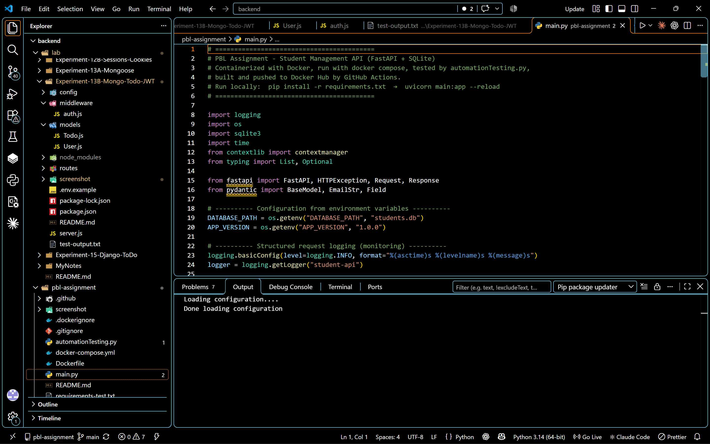
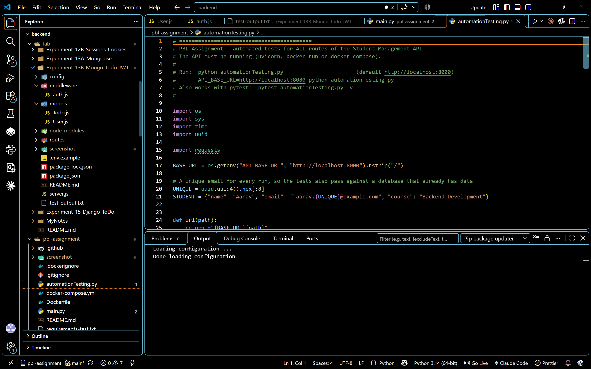
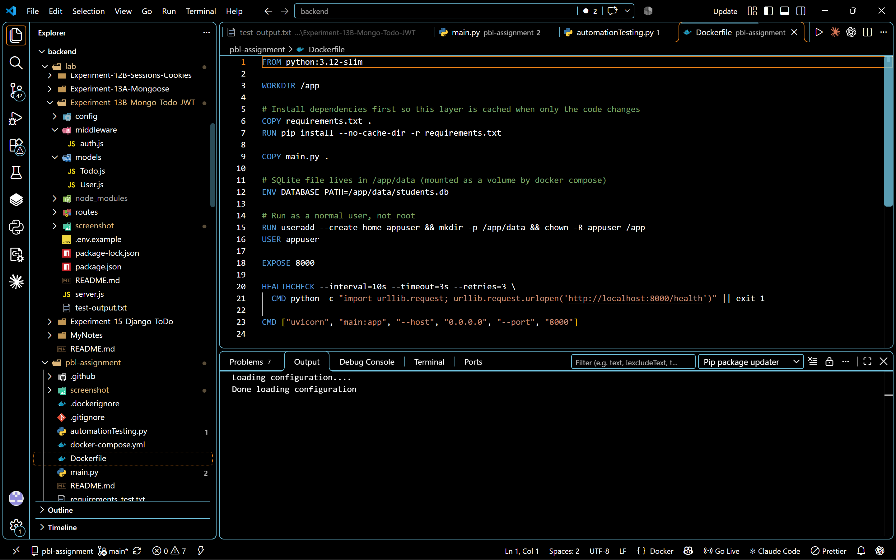
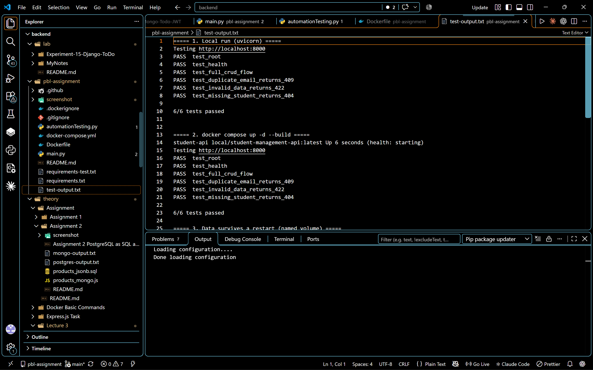

# PBL Assignment — Student Management API (Docker to CI/CD)

**Course:** Backend Development (CSFS3008P) | **PBL**

---

Code to tests to Docker image to Docker Hub, fully automated with GitHub Actions.

## Overview

| | |
|---|---|
| **Source** | `Theory/Unit 4/001 Combined Hands On Task.md` — PBL tasks 1–5 |
| **Repository** | [UdayBansal0109/Backend-PBL](https://github.com/UdayBansal0109/Backend-PBL) |
| **Image** | `<dockerhub-username>/student-management-api:latest` and `:sha-<commit>` |

## Technologies

Python, FastAPI, SQLite, Docker, Docker Compose, GitHub Actions

---

## Pipeline

```
git push --> GitHub Actions
              |- job 1: test             install -> start API -> python automationTesting.py
              '- job 2: build-and-push   (needs: test) docker build -> run container -> tests again
                                          -> docker login (secrets) -> push :latest + :sha-<commit>
```

## Folder Structure

```
pbl-assignment/
├── main.py                       # FastAPI + SQLite Student API
├── automationTesting.py          # Tests every route
├── Dockerfile                    # python:3.12-slim, cached deps, non-root user, HEALTHCHECK
├── .dockerignore
├── docker-compose.yml            # Service + named volume
├── requirements.txt
├── requirements-test.txt
├── .github/workflows/ci-cd.yml   # test -> build -> push
└── test-output.txt
```

## API Routes

| Method | Route | Purpose |
|:-:|---|---|
| `GET` | `/` | App name, version, status |
| `GET` | `/health` | Health check (also checks the database) |
| `GET` | `/students?course=` | List students (optional filter) |
| `POST` | `/students` | Create — 409 duplicate email, 422 invalid data |
| `GET` | `/students/{id}` | Read one — 404 if missing |
| `PUT` | `/students/{id}` | Update — 404 if missing |
| `DELETE` | `/students/{id}` | Delete — 404 if missing |

---

## PBL Tasks

| # | Task | File(s) |
|---|---|---|
| 1 | Replace the tutorial's source with a previous project | `main.py` — Student Management API rewritten as a small FastAPI + SQLite app (CRUD, filter, 404/409/422, `/health`, structured request logs) |
| 2 | Containerize the app with a Dockerfile | `Dockerfile` (cached dependency layer, non-root user, `HEALTHCHECK`), `.dockerignore` |
| 3 | Run the service with docker-compose | `docker-compose.yml` (port 8000, named volume so data survives restarts, restart policy) |
| 4 | Write `automationTesting.py` that tests all routes | Tests `/`, `/health`, `GET/POST /students`, `GET/PUT/DELETE /students/{id}`, `?course=` filter, 409 duplicate, 422 invalid data, 404 missing |
| 5 | GitHub Action: run the tests, then build and push to Docker Hub | `.github/workflows/ci-cd.yml` — job `test` then job `build-and-push` (`needs: test`) |

## Run Locally

```bash
# Without Docker
pip install -r requirements.txt -r requirements-test.txt
uvicorn main:app --reload                      # http://localhost:8000/docs
python automationTesting.py                    # in a second terminal

# With Docker Compose
docker compose up -d --build
python automationTesting.py
docker compose logs -f student-api
docker compose down                            # add -v to also delete the data volume
```

## Execution Screenshots

### FastAPI Main Code

`main.py` in VS Code — FastAPI Student Management API with SQLite, CRUD routes, health check and structured logging.



### Automation Testing Code

`automationTesting.py` in VS Code — test suite covering all API routes including edge cases (409, 422, 404).



### Dockerfile

`Dockerfile` in VS Code — Python 3.12-slim base, cached dependencies, non-root user and HEALTHCHECK.



### Test Output

`test-output.txt` in VS Code — 6/6 tests passing against both local uvicorn and containerized API.



---

## Verification Results

| Check | Result |
|---|---|
| `automationTesting.py` against uvicorn | 6/6 passed |
| `docker compose up -d --build` | Container `student-api` healthy |
| `automationTesting.py` against the container | 6/6 passed |
| Data after `docker compose restart` | Student still present (named volume) |
| Logs | `method=... path=... status=... duration_ms=...` for every request |
| Workflow file | Valid YAML, jobs `test` then `build-and-push` |

## Run the Pipeline on GitHub

1. Docker Hub: Account Settings, Personal access tokens, create a token with Read and Write.
2. This repository: Settings, Secrets and variables, Actions. Add `DOCKERUSERNAME` (Docker Hub username) and `DOCKERTOKEN` (the token). Never commit the token.
3. Actions tab: **Test, build and push to Docker Hub**, Run workflow (or push to `main`). Expected: Automation tests pass, then Build, smoke-test and push image passes.
4. Check `https://hub.docker.com/r/<dockerhub-username>/student-management-api` for `latest` and `sha-...` tags.

```bash
docker pull <dockerhub-username>/student-management-api:latest
docker run --rm -p 8000:8000 <dockerhub-username>/student-management-api:latest
```

Until the two secrets are added, the test job and the Docker build/smoke test still run; only the Docker Hub login/push steps fail.

## Why the Pipeline is Ordered This Way

- Tests run first; `needs: test` means a failing test stops the build, so a broken image is never pushed.
- The image is tested again as a container (smoke test) — this catches Dockerfile mistakes that unit tests miss.
- Pushing only happens on `push` to `main` — pull requests are tested but never published.
- The token is read from `secrets.DOCKERTOKEN` with `--password-stdin`, so it never appears in the file or the logs.
- The `sha-<commit>` tag identifies exactly which commit is inside the image and allows rollback; `latest` always moves.

---

<div align="center">

Part of the [Backend Development coursework](https://github.com/UdayBansal0109/BackendDevelopment) | [Coursework website](https://udaybansal0109.github.io/BackendDevelopment/)

</div>
